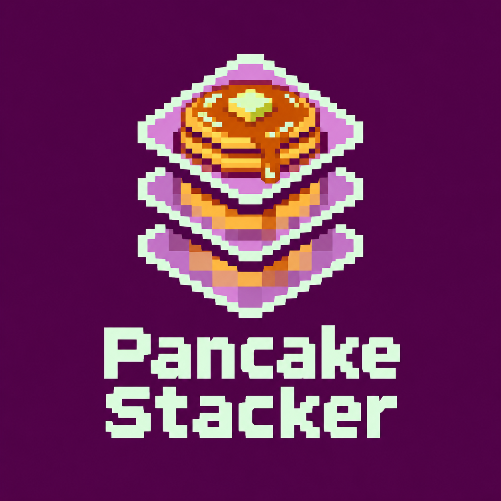

<h1 align="center">
  
</h1>

Pancake Stacker is a free, open-source desktop app for focus stacking. Combine photos focused at different distances into one image with more of your subject in focus.

## Download Pancake

**[Get the newest Pancake release](https://github.com/tasercake/pancake/releases)** and choose the file for your computer under **Assets**. The package names below show where the version number appears.

| Your computer | Download and launch |
| --- | --- |
| **Mac with Apple Silicon** | Download `pancake-<version>-macos-arm64.zip`. Unzip it, move `Pancake.app` to **Applications**, and open it. [macOS first-launch help](pancake/docs/install.md#macos-apple-silicon) |
| **Windows x64** | Download `pancake-<version>-windows-x64.zip`. Choose **Extract All**, then open `pancake-gui.exe` in the extracted folder. [Windows first-launch help](pancake/docs/install.md#windows-x64) |
| **Ubuntu 24.04 x86-64** | Download `pancake_<version>_amd64.deb`. Install it with APT and open **Pancake** from the application menu. [Ubuntu install command](pancake/docs/install.md#ubuntu-2404-x86-64) |

## Stack your first photos

1. Pick two or more photos of the same subject, each focused on a different part. Start with JPEGs or TIFFs of the same dimensions.
2. In Pancake, choose **Open files…** and select your photos. Use **Open folder…** if the folder contains just the frames you want to stack.
3. Leave the stack method on **Hybrid** and click **Start stack**.
4. Use **Compare** or **1:1** to check the result. Click **Export**, choose **TIFF** and **16-bit**, then click **Continue…** and save the file.

See the [desktop guide](pancake/docs/desktop.md) for capture tips, alignment settings, and supported formats.

## Highlights

- **Focus stacking and exposure fusion.** Choose from four focus-stacking methods or blend an exposure bracket.
- **Frame alignment and cropping.** Correct for camera shifts and focus breathing, then trim the edges introduced by alignment.
- **Full-size comparison.** Compare a source frame with the result using a split view and inspect detail at 1:1.
- **Local processing.** Stack on your CPU or a compatible GPU. Your photos stay on your computer.
- **Lightroom Classic on macOS.** Send originals or 16-bit TIFFs with your Lightroom edits straight to Pancake. [Lightroom Classic setup](pancake/docs/desktop.md#lightroom-classic-on-macos)

## Documentation

[Installation](pancake/docs/install.md) · [Desktop and Lightroom](pancake/docs/desktop.md) · [Command line](pancake/docs/cli.md) · [All Pancake docs](pancake/docs/)

## Build from source

See the [developer guide](pancake/DEVELOPING.md#build-from-source) for build prerequisites, test commands, and the Rust workspace. Pancake is licensed under the [GPL-3.0-or-later](pancake/LICENSE).

The repository also houses [BokehForge](bokehforge/), a companion toolkit for datasets and benchmarking, and [focus-stacking research](research/).
