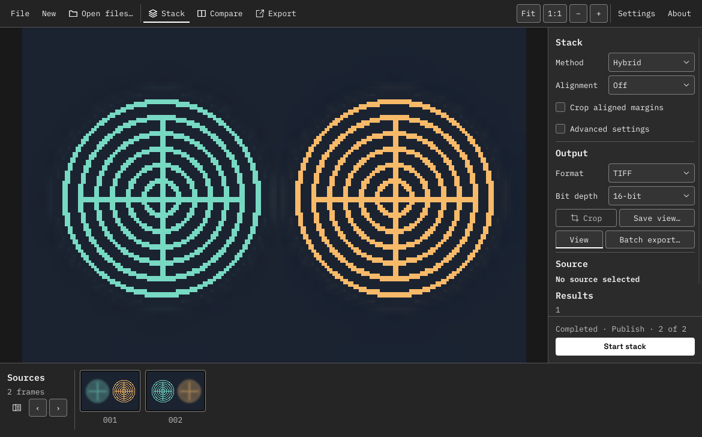

# Stack your photos in Pancake Stacker

[Install Pancake Stacker](install.md), then open the desktop app.

## Make a focus stack

1. Shoot the same composition at several focus distances so every part you want sharp is in focus in at least one frame. For a first stack, use a stationary subject, consistent lighting and exposure, and a tripod if you have one.
2. Click **Open files…** and select two or more frames, or choose **File → Open folder…** to load a folder of frames. Start with JPEGs or TIFFs of the same dimensions.
3. In the **Stack** inspector, leave **Hybrid** selected and click **Start stack**. The result appears in the viewer when processing finishes.
4. Click **Compare** to inspect a source frame and the result in a split view. Click **1:1** to check fine detail and **Fit** to see the whole image.
5. Click **Export**. Choose **TIFF** and **16-bit** for a file you can edit further, or **JPEG** for a smaller file to share. Click **Continue…** and choose where to save it.

If you have no stack handy, save both sample frames ([near focus](../../assets/quickstart/focus-near.png) and [far focus](../../assets/quickstart/focus-far.png)) and open them together.

## Browse sources and adjust the workspace

The filmstrip shows source frames in processing order. Click a thumbnail to
inspect that frame, or use the arrow keys with the viewer focused. The current
frame has an outlined thumbnail and a numbered marker. Use **Files** to
reveal the full source list or manage the selection.

Pancake Stacker starts in the graphite theme. In **Preferences**, you can choose the
light theme or enter an accent as a six-digit color such as `#dabb91`. Pancake Stacker
adjusts the displayed shade for contrast and saves your original choice. The
default accent is white.

## Adjust a stack

| If you see… | Try… |
| --- | --- |
| A small shift between frames | Set **Alignment** to **Translation** and stack again. |
| The subject changes size slightly as you refocus | Try **Breathing** alignment. |
| Uneven edges after alignment | Enable **Crop aligned margins** before stacking, or use **Crop** on the result when available. |
| Different brightness across a bracket with the same focus | Choose **Exposure fusion** to blend the bracket. |
| A GPU processing error | Open **Preferences**, set **Processing device** to **CPU**, and try again. |

## File formats

Pancake Stacker opens JPEG, PNG, TIFF, BMP, OpenEXR, NumPy arrays (`.npy`), and supported DNG and Canon CR3 raw files. If your camera files fail to open, export the frames from your raw editor as matching 16-bit TIFFs and use those.

The app exports 8- or 16-bit TIFF and PNG, JPEG, and OpenEXR. TIFF export can retain an embedded ICC profile when the profile is identical across all frames.

## Lightroom Classic on macOS

1. Keep Pancake Stacker in a stable location. For a packaged `Pancake Stacker.app`, use **Applications**. For a local build, you can use the standalone `pancake-gui` executable.
2. Open Pancake Stacker and choose **Preferences → Install Lightroom plug-in**. Restart Lightroom Classic if it was open.
3. Select at least two photos in Lightroom Classic. Right-click the selection and open **Export**. Choose **Pancake Stacker (Originals)** for supported source files or **Pancake Stacker (With Lightroom Edits)** for full-size 16-bit sRGB TIFFs. Both commands are also available under **File → Plug-in Extras**.
4. Stack and export in Pancake. Use Lightroom Classic's **Import** command to bring the result back into your catalog.

If you move Pancake Stacker to a different location, open it there and reinstall the plug-in from **Preferences**. Pancake Stacker removes the temporary TIFFs from **With Lightroom Edits** when the instance that uses them closes.
